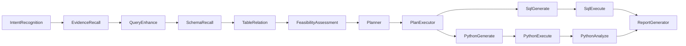

<div align="center">
  <p>中文 | <a href="./README-en.md">English</a></p>
  <h1>DataAgent ProMax</h1>
  <p>
    <strong>基于 <a href="https://github.com/spring-ai-alibaba/DataAgent">Spring AI Alibaba DataAgent</a> 二次开发的企业级 NL2SQL 智能分析 Agent</strong>
  </p>
  <p>
    Agentic Schema Linking · 混合检索 + 精排 · Elasticsearch 向量库 · 可复现评测体系
  </p>
  <p>
    
    
    
    
  </p>
  <p>
    <a href="#-项目简介">项目简介</a> •
    <a href="#-相对上游的核心改进">核心改进</a> •
    <a href="#-系统架构">系统架构</a> •
    <a href="#-快速开始">快速开始</a> •
    <a href="#-复现评测">复现评测</a> •
    <a href="#-文档导航">文档导航</a>
  </p>
</div>

## 📖 项目简介

**DataAgent ProMax** 是在 [Spring AI Alibaba DataAgent](https://github.com/spring-ai-alibaba/DataAgent) 基础上二次开发的企业数仓智能分析 Agent。上游已经提供了完整的 NL2SQL、Python 深度分析、报告生成和 MCP 能力；本仓库聚焦上游在**大规模 schema 场景**下的短板，补齐了三件事：

1. **可复现的评测体系**：自建多档规模的企业数仓合成数据集与多题型问题集，覆盖召回评测与端到端执行评测；
2. **Agentic Schema Linking**：把"一次表向量检索"升级为"表家族分组 → 列级热启动 → LLM 调工具补全 → 只增不删合并"，并补上关系图与 JOIN 路径；
3. **检索与存储基础设施**：向量库迁移 Elasticsearch，知识检索加入父子分块、向量 + BM25 混合召回与可选精排，同时修复上游若干可复现性与稳定性问题。

> 量化对比将在最新一轮优化评测完成后补充。

## 🚀 相对上游的核心改进

### 1. 可复现的企业数仓评测体系

- **数据集生成器**（`tools/dataset-gen`）：以核心业务表为基础，按规则派生 DIM / DWD / DWS / ADS 分层表，并注入按月/按日分表、`_bak` 备份、个人副本等噪声；支持多档表规模，题集覆盖 `multi_hop`、`time_reasoning`、`metric`、`value_match`、`ambiguous_table` 等题型；
- **可复现**：同一配置重复生成逐字节一致；一致性与可执行性校验全部通过；
- **召回评测**（`SchemaRecallBenchmarkIT`）：走生产初始化路径，输出全命中率 / Recall@k、按题型分组、失败清单；
- **端到端评测**（`EndToEndBenchmarkIT`）：召回 → 生成 SQL → 执行 → 与标准答案比对，严格 / 宽松 / 近似多种口径；
- **大模型响应磁盘缓存**（`CachingChatModel`）：同样请求只调用一次，评测可复现、重跑零成本；配合双环境逐题比较，抓出了多个不确定性 bug。

### 2. Agentic Schema Linking

原有实现只做一次表级向量检索，候选数写死，表文档只有一句注释。改造分三阶段：

- **表家族分组** `TableFamilyClassifier`："名字找候选、列来判定"，把分表、备份、个人副本归入正表；噪声表基本全部归入正表，无错误合并，数千张表分组在毫秒级完成；
- **列级热启动**：只检索家族代表表的列，列文本改为"列名; 表名 表注释; 类型; 列注释"，按表聚合；
- **LLM 工具补全** `SchemaCompletionAgent`：提供 `retrieve_schema`、`describe_tables`、`expand_family`、`explore_schema`、`verify_schema` 等只读工具，限行数、限超时、限制调用轮次，失败自动退回热启动结果；
- **只增不删合并**：大模型选出的表排前面，热启动候选接在后面，不删除。评测发现模型偏好汇总表、会误删正表；改为该策略后，全命中率显著提升。

改造通过 `SchemaLinker` 接口 + 配置开关接入（绞杀者模式），原实现原样保留，现有测试无需改动。

### 3. 关系图与 JOIN 补全

- 在家族代表表之间推断物理外键、逻辑关系、命名推断等加权边，按可信度赋权；命名推断只连接单列主键，避免多对多放大行数；
- 按数据源 TTL 缓存关系图，数千张表冷启动建图在秒级完成；
- 用 **Takahashi–Matsuyama Steiner 算法**在召回表之间寻找最小连通路径，自动补中间表并生成 JOIN 提示；
- 多跳题的严格执行准确率明显提升。

### 4. 知识检索：父子分块 + 混合检索 + 精排

- **父子分块**：docx / pdf / txt / md 统一转 Markdown，按章节切父块、父块内切不重叠子块（带标题路径）；子块匹配、父块作答；
- **混合召回**：向量 + BM25，向量门控挡住无关查询，RRF 融合；
- **精排**：内置一个与 TEI / Jina 接口同形的本地 reranker 服务（`tools/reranker`），支持 encoder 式（bge-reranker）与 decoder 式（Qwen3-Reranker）模型；Java 侧通过 `KnowledgeReranker` 调用，可配置候选数、分数阈值与返回条数；
- 评测：在自建知识检索评测集上验证，混合召回与精排均带来稳定的头部排序提升。

### 5. Elasticsearch 向量库

- 抽象 `VectorStoreExtension`：在 Spring AI `VectorStore` 之外提供按 metadata 精确查询、只改 metadata 的能力，内存 / ES / Milvus 各一个实现；
- **召回开关写入文档 metadata**：检索时不再先查 MySQL 拼过滤条件，切换失败回滚 MySQL，启动时全量同步；
- **`StableElasticsearchVectorStore`**：改用 float HNSW、放大 `num_candidates`、打平时确定性排序，解决 ES 8 默认 int8 量化导致的检索结果不可复现；结果与内存实现逐项一致；
- **批量写入**：大批量初始化分批提交，避免单次 bulk 请求过大被 ES 拒绝；
- 评测支持 `-Dbenchmark.vector-store=elasticsearch`，可与内存实现逐题对比。

### 6. 上游缺陷修复

| 缺陷 | 影响 |
| :--- | :--- |
| 初始化 SQL 末尾的固定行数限制 | 超过限制的表被静默丢弃，大档只初始化了部分表 |
| `SimpleVectorStore` 打平时顺序随机 | 内容相同的备份表随机挤掉正表，结果不可复现 |
| 非流式调用 DeepSeek 响应被截断 | 大模型补全偶发解析失败 |
| 默认 `max_tokens` 过小 | 推理模型思考用完额度，返回空 SQL（已调大默认值） |
| ES 过滤转换器把 `!=` 转成非法语法 | 开启 ES 后检索报错 |
| 单次 bulk 写入文档过多 | 请求体过大被 ES 拒绝，大档初始化失败（改为分批） |

## 🏗️ 系统架构

工作流基于 Spring AI Alibaba `StateGraph` 编排，SSE 向前端推送每个节点的进度，支持 checkpoint 断点续跑：



本仓库的主要改动集中在 `SchemaRecall`（`SchemaLinker` 策略切换）、`TableRelation`（JOIN 补全）、`EvidenceRecall`（知识检索与精排），以及离线初始化与评测链路。

## ⚡ 快速开始

### 环境要求

- JDK 17+
- MySQL 5.7+（或使用内置 H2 profile）
- Node.js 22+ / pnpm
- Docker（Python 节点需要）
- 可选：Elasticsearch 8.x、Ollama（本地 Embedding）、任意 OpenAI 兼容对话模型

### 1. 配置环境变量

```bash
cp .env.example .env    # 填写数据库密码、模型 Key 等
```

`.env` 已被 `.gitignore` 忽略。注意 Spring Boot **不会**自动读取 `.env`：本地启动请用 shell `export`、IDE Run Configuration 或 `-Dspring-boot.run.arguments` 注入；docker compose 读取的是 `docker-file/` 下的 `.env`。

### 2. 启动后端

```bash
# 方式 A：H2 内存库，零依赖快速体验
./mvnw -pl data-agent-management spring-boot:run -Dspring-boot.run.profiles=h2

# 方式 B：MySQL（先用 schema.sql 建库）
mysql -u root -p < data-agent-management/src/main/resources/sql/schema.sql
./mvnw -pl data-agent-management spring-boot:run

# 方式 C：MySQL + Elasticsearch 向量库
./mvnw -pl data-agent-management spring-boot:run -Dspring-boot.run.profiles=elasticsearch
```

模型 API Key 在系统「模型配置」页面维护，也可通过环境变量注入。

### 3. 启动前端

```bash
cd data-agent-frontend-nuxt
pnpm install && pnpm dev
```

访问 <http://localhost:3000>。详细配置见 [快速开始文档](docs/QUICK_START.md)。

## 📊 复现评测

### 生成数据集

```bash
cd tools/dataset-gen
python -m pip install --user -r requirements.txt
python gen.py --config config/s2-large.yaml          # 全流程
python gen.py --config config/s2-large.yaml --steps validate
```

### 召回评测

```bash
./mvnw -B -pl data-agent-management test -Dtest=SchemaRecallBenchmarkIT \
  -Dbenchmark.vector-store=elasticsearch \
  -Dbenchmark.schema=enterprise_dw_l \
  -Dbenchmark.questions=../tools/dataset-gen/questions/s2.jsonl \
  -Dbenchmark.label=schema-large \
  -Djacoco.skip=true
```

### 端到端执行评测

```bash
./mvnw -B -pl data-agent-management test -Dtest=EndToEndBenchmarkIT \
  -Dbenchmark.schema=enterprise_dw_m \
  -Dbenchmark.questions=../tools/dataset-gen/questions/s2.jsonl \
  -Dbenchmark.linker=agentic \
  -Dbenchmark.label=e2e-medium \
  -Djacoco.skip=true
```

### 知识检索评测（含精排）

```bash
# 先启动本地 reranker（可选）
tools/reranker/.venv/Scripts/python tools/reranker/server.py \
  --model BAAI/bge-reranker-base --max-chars 300 --batch 4 --threads 4

./mvnw -B -pl data-agent-management test -Dtest=KnowledgeRetrievalBenchmarkIT \
  -Dbenchmark.vector-store=elasticsearch \
  -Dbenchmark.hybrid=true \
  -Dbenchmark.knowledge.splitter=parent-child \
  -Dbenchmark.knowledge.rerank=true \
  -Dbenchmark.knowledge.rerank-ranking=true \
  -Djacoco.skip=true
```

报告输出在 `data-agent-management/target/*-benchmark/<时间戳>-<label>/`，包含 `report.json` 与 `summary.md`。完整开关见各评测类源码。

## 📚 文档导航

> 评测报告与设计文档将在最新一轮优化完成后补充。

| 文档 | 内容 |
| :--- | :--- |
| [快速开始](docs/QUICK_START.md) | 环境要求、数据库导入、基础配置 |
| [架构设计](docs/ARCHITECTURE.md) | 分层架构与工作流设计 |
| [开发者指南](docs/DEVELOPER_GUIDE.md) | 开发环境、配置手册、扩展开发 |
| [高级功能](docs/ADVANCED_FEATURES.md) | API Key、MCP、混合检索、Python 沙盒 |
| [知识配置最佳实践](docs/KNOWLEDGE_USAGE.md) | 语义模型、业务知识与智能体知识 |

## 📄 版权与许可

本项目是 **Spring AI Alibaba DataAgent** 的衍生作品，遵循 [Apache License 2.0](LICENSE)。

- 上游项目：<https://github.com/spring-ai-alibaba/DataAgent>（Copyright 2024-2026 the original author or authors）
- 本仓库的修改说明与衍生关系见 [NOTICE](NOTICE)
- 本仓库不是 Alibaba / Spring AI Alibaba 官方发行版

原始文件保留其原有版权声明；本仓库新增文件同样以 Apache License 2.0 发布。
