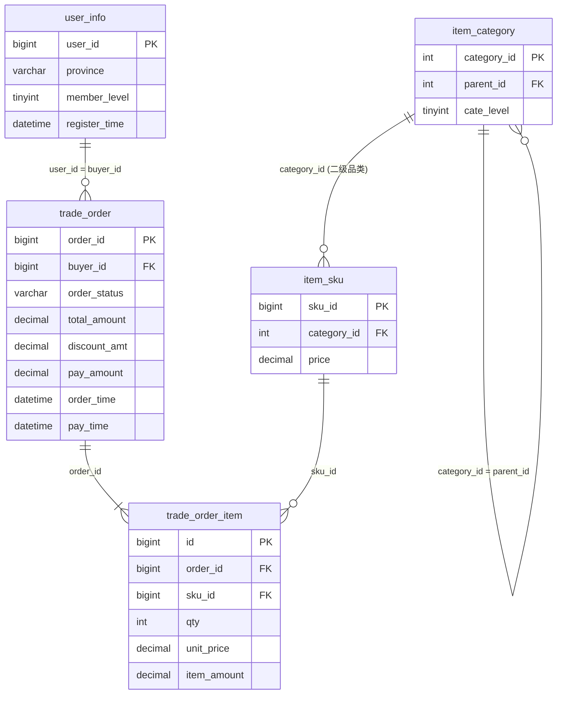
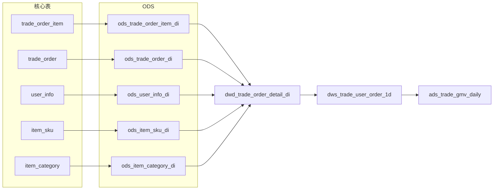

# enterprise_dw 表说明与表关系

本文说明 `tools/dataset-gen` 用 `config/m0.yaml` 生成的 `enterprise_dw` 库（M0 规模）：每张表的作用、字段含义，以及表之间的关系。

> - 字段说明来自**退化前**的干净元数据（`out/clean_metadata.json`）。库里实际的注释已经被有意删掉一部分，这是测试设计的一部分，不是 bug。
> - 行数是 M0 配置、种子 42 的实测值。改配置或种子后会变化。
> - 生成方式见 [IMPLEMENTATION.md](IMPLEMENTATION.md)。

## 1. 总览

共 44 张表，分三类：

| 类别 | 表数 | 作用 | 是否用于标准答案 |
|---|---|---|---|
| 核心业务表 | 5 | 电商交易的源数据，数据完整且一致 | 是，`gold_sql` 只引用这些表 |
| 派生分层表 | 8 | 模拟数仓 ODS → DWD → DWS → ADS，全部由 SQL 从上游计算 | 部分题的 `alt_sqls` 会用到 |
| 噪声表 | 31 | 备份、临时、旧版本、测试、个人副本、按月分表，用于干扰召回 | 否 |

命名规则：

| 前缀 / 后缀 | 含义 |
|---|---|
| `user_`、`item_`、`trade_` | 核心业务表，按业务域区分：用户、商品、交易 |
| `ods_…_di` | ODS 层，源表原样同步；`_di` 表示按天增量（daily incremental） |
| `dwd_…_di` | DWD 层，清洗后的明细宽表 |
| `dws_…_1d` | DWS 层，按某个粒度汇总；`_1d` 表示统计周期为 1 天 |
| `ads_…` | ADS 层，面向报表的结果表 |
| `_bak`、`_bak_YYYYMMDD` | 备份表 |
| `tmp_` | 临时表 |
| `_v1`、`_old` | 旧版本表，比正表少几列 |
| `test_` | 测试表，空表 |
| `u_{人名}_…_analysis` | 个人分析用的副本 |
| `_YYYYMM` | 按月分表 |

## 2. 表关系

### 2.1 核心表 ER 图



关联关系清单：

| 关系 | 基数 | 当前是否有物理外键 |
|---|---|---|
| `trade_order.buyer_id` → `user_info.user_id` | 一个用户有 0 到多笔订单 | 有（`fk_order_buyer`） |
| `trade_order_item.order_id` → `trade_order.order_id` | 一笔订单有 1～5 条明细 | 有（`fk_item_order`） |
| `trade_order_item.sku_id` → `item_sku.sku_id` | 一个商品出现在多条明细中 | **已删除**（退化） |
| `item_sku.category_id` → `item_category.category_id` | 商品只挂在二级品类上 | **已删除**（退化） |
| `item_category.parent_id` → `item_category.category_id` | 二级品类指向一级品类 | 有（`fk_category_parent`） |

有两条外键在退化阶段被删掉了，模拟企业里外键不全的情况。召回时这两条关系只能靠字段名推断或人工配置的逻辑外键来发现。

注意 `buyer_id` 和 `user_id` 名字不同但指向同一个实体，这是有意留下的不规范命名。

### 2.2 分层血缘



派生层表之间没有物理外键，数仓里通常也不建。

### 2.3 噪声表和源表的对应

| 源表 | 派生出的噪声表 |
|---|---|
| `user_info` | `user_info_bak`、`user_info_bak_20250315`、`user_info_bak_20250825`、`user_info_old`、`test_user_info`、`tmp_info_1224`、`u_liuyang_info_analysis` |
| `item_sku` | `item_sku_bak`、`item_sku_bak_20250721`、`item_sku_bak_20250811`、`item_sku_v1`、`tmp_sku_0224` |
| `trade_order` | `trade_order_bak`、`trade_order_bak_20251102`、`trade_order_v1`、`trade_order_202501` ～ `trade_order_202512`（12 张）、`u_lisi_order_analysis`、`u_zhangsan_order_analysis` |
| `trade_order_item` | `trade_order_item_bak`、`trade_order_item_v1` |

## 3. 核心业务表

### 3.1 `user_info` 用户基础信息表（2,000 行）

| 字段 | 类型 | 含义 |
|---|---|---|
| `user_id` | BIGINT, PK | 用户 ID，从 1000001 开始 |
| `user_name` | VARCHAR(50) | 用户姓名（随机生成的中文名） |
| `gender` | CHAR(1) | 性别：`M` 男、`F` 女、`U` 未知 |
| `birth_year` | SMALLINT | 出生年份，约 5% 为空 |
| `province` | VARCHAR(20) | 常住省份，带"省/市"后缀，如 `浙江省`、`上海市` |
| `city` | VARCHAR(20) | 常住城市，如 `杭州市`；**约 1% 为空**（有意注入的脏数据） |
| `member_level` | TINYINT | 会员等级：1 普通、2 白银、3 黄金、4 铂金、5 钻石 |
| `register_time` | DATETIME | 注册时间，范围 2023-01-01 ～ 2025-12-01 |

用户按活跃度分层（高活 10%、普通 40%、低活 30%、沉睡 20%），层级决定下单频率和会员等级，所以高等级会员下单更多。

### 3.2 `item_category` 商品品类表（22 行）

两级品类，7 个一级品类、15 个二级品类。

| 字段 | 类型 | 含义 |
|---|---|---|
| `category_id` | INT, PK | 品类 ID。一级品类为 10100、10200…；二级品类 = 一级 ID + 序号，如 10101 |
| `category_name` | VARCHAR(50) | 品类名称 |
| `parent_id` | INT | 父品类 ID；一级品类为空 |
| `cate_level` | TINYINT | 层级：1 一级品类，2 二级品类 |

品类清单：

| 一级品类 | 二级品类 |
|---|---|
| 手机数码 | 手机、耳机 |
| 电脑办公 | 笔记本、显示器 |
| 家用电器 | 厨房电器、生活电器 |
| 服装鞋帽 | 男装、女装、运动鞋 |
| 美妆个护 | 护肤、彩妆 |
| 食品饮料 | 零食、饮料 |
| 图书 | 小说、教辅 |

查一级品类的销售数据，需要 `item_sku → item_category(二级) → item_category(一级)` 自连接，是一道典型的多跳关联题。

### 3.3 `item_sku` 商品 SKU 表（300 行）

| 字段 | 类型 | 含义 |
|---|---|---|
| `sku_id` | BIGINT, PK | 商品 ID，从 10000001 开始 |
| `sku_name` | VARCHAR(100) | 商品名称，格式为"品牌 商品名 款式"，如 `松果 折叠屏手机 标准版` |
| `category_id` | INT | 所属**二级**品类 ID |
| `brand_name` | VARCHAR(50) | 品牌（12 个虚构品牌，如 星河、北辰） |
| `price` | DECIMAL(10,2) | 当前售价（元），按二级品类的价格区间生成 |
| `stock` | INT | 当前库存；**有 2 个商品为负数**（有意注入的脏数据） |
| `sku_status` | VARCHAR(20) | `on_sale` 在售、`off_shelf` 已下架（约 8%） |
| `created_time` | DATETIME | 上架时间，均早于 2025 年 |

### 3.4 `trade_order` 交易订单主表（20,000 行）

| 字段 | 类型 | 含义 |
|---|---|---|
| `order_id` | BIGINT, PK | 订单 ID，从 2000000001 开始，随下单时间递增 |
| `buyer_id` | BIGINT | 下单用户 ID，关联 `user_info.user_id` |
| `order_status` | VARCHAR(20) | 订单状态，见下表 |
| `total_amount` | DECIMAL(12,2) | 商品总金额（元）= 该订单所有明细的 `item_amount` 之和 |
| `discount_amt` | DECIMAL(12,2) | 优惠金额（元）；约 30% 的订单有优惠，为总额的 5%～20% |
| `pay_amount` | DECIMAL(12,2) | 应付/实付金额（元）= `total_amount - discount_amt` |
| `receiver_province` | VARCHAR(20) | 收货省份；90% 与买家常住省份相同 |
| `order_time` | DATETIME | 下单时间，全部在 2025 年内 |
| `pay_time` | DATETIME | 支付时间，下单后 10 秒～30 分钟；未支付为空 |

订单状态：

| 值 | 含义 | 占比（实测） | 有无 `pay_time` |
|---|---|---|---|
| `completed` | 已完成 | 72.2% | 有 |
| `shipped` | 已发货 | 7.9% | 有 |
| `cancelled` | 已取消 | 7.0% | 无 |
| `refunded` | 已退款 | 5.2% | 有 |
| `paid` | 已支付 | 4.9% | 有 |
| `created` | 待支付 | 2.8% | 无 |

时间分布：有周末上浮和大促峰值（双11 当天支付订单 315 单，平日约 49 单；6/18、12/12 也有峰值），一天内的下单高峰在晚上 8～9 点。

⚠️ 当前库里 `pay_amount` 的注释被故意改错，末尾多了"（单位：分）"，但实际存的是元。这是注释误标的退化测试。

### 3.5 `trade_order_item` 交易订单明细表（35,138 行）

| 字段 | 类型 | 含义 |
|---|---|---|
| `id` | BIGINT, PK | 明细 ID，从 50000001 开始 |
| `order_id` | BIGINT | 所属订单 ID |
| `sku_id` | BIGINT | 商品 ID |
| `qty` | INT | 购买件数（1～3） |
| `unit_price` | DECIMAL(10,2) | 成交单价（元），等于商品当前售价 |
| `item_amount` | DECIMAL(12,2) | 明细金额（元）= `qty × unit_price` |

商品销量服从长尾分布：头部 5% 的商品贡献约 58% 的销量。同一订单内商品不重复。

### 3.6 金额关系与业务口径

```
item_amount  = qty × unit_price
total_amount = Σ item_amount（同一订单）
pay_amount   = total_amount − discount_amt
```

题集使用的口径：

| 指标 | 口径 |
|---|---|
| GMV / 销售额 | 已支付过的订单（`pay_time IS NOT NULL`，**含后续退款**）的明细金额之和，按下单时间统计 |
| 客单价 | 已支付订单的 `pay_amount` 之和 / 已支付订单数 |
| 复购率 | 已支付订单数 ≥ 2 的用户数 / 已支付订单数 ≥ 1 的用户数 × 100 |

因为 GMV 用的是商品金额（`item_amount` 之和 = `total_amount`），不扣优惠，所以 GMV 和"实付金额之和"不是同一个数，这也是题目考察口径的地方。

## 4. 派生分层表

### 4.1 ODS 层（5 张）

| 表 | 源表 | 行数 |
|---|---|---|
| `ods_user_info_di` | `user_info` | 2,000 |
| `ods_item_category_di` | `item_category` | 22 |
| `ods_item_sku_di` | `item_sku` | 300 |
| `ods_trade_order_di` | `trade_order` | 20,000 |
| `ods_trade_order_item_di` | `trade_order_item` | 35,138 |

字段 = 源表全部字段 + 下面两列，数据与源表完全一致：

| 字段 | 含义 |
|---|---|
| `etl_time` | ETL 同步时间，固定为 `2026-01-01 02:00:00` |
| `dt` | 分区日期，固定为 `2026-01-01` |

表注释为"ODS-" + 源表注释（部分已被退化删除）。

### 4.2 `dwd_trade_order_detail_di` 交易订单明细宽表（35,138 行）

粒度：一行一条订单明细。把订单、用户、商品、品类的常用字段冗余到一起，查询时不用再 JOIN。

| 字段 | 含义 | 来源 |
|---|---|---|
| `id` | 明细 ID | 明细表 |
| `order_id` | 订单 ID | 明细表 |
| `buyer_id` | 买家用户 ID | 订单表 |
| `member_level` | 买家会员等级 | 用户表 |
| `receiver_province` | 收货省份 | 订单表 |
| `sku_id` / `sku_name` / `brand_name` | 商品 ID、名称、品牌 | 商品表 |
| `category2_id` / `category2_name` | 二级品类 | 品类表 |
| `category1_id` / `category1_name` | 一级品类 | 品类表（父级） |
| `qty` / `unit_price` / `item_amount` | 件数、单价、明细金额 | 明细表 |
| `order_status` | 订单状态 | 订单表 |
| `is_paid` | 是否已支付：1 是、0 否（`pay_time` 非空即为 1） | 计算 |
| `order_time` / `order_date` | 下单时间、下单日期 | 订单表 |
| `dt` | 分区日期 | ODS |

### 4.3 `dws_trade_user_order_1d` 用户粒度交易日汇总（19,102 行）

粒度：一行 = 一个用户在一天内的交易汇总。主键 `(stat_date, buyer_id)`，只有当天下过单的用户才有记录。

| 字段 | 含义 |
|---|---|
| `stat_date` | 统计日期（按下单日期） |
| `buyer_id` | 买家用户 ID |
| `order_cnt` | 当天下单数 |
| `paid_order_cnt` | 当天下单且已支付的订单数 |
| `paid_amount` | 这些已支付订单的明细金额之和（元） |

### 4.4 `ads_trade_gmv_daily` 每日 GMV 报表（365 行）

粒度：一天一行，覆盖 2025 全年。

| 字段 | 含义 |
|---|---|
| `stat_date` | 统计日期 |
| `gmv` | 当日 GMV（元），口径同 3.6 |
| `paid_order_cnt` | 当日支付订单数 |
| `paid_buyer_cnt` | 当日支付买家数 |

数据校验保证：ADS 全年 GMV 总额、支付订单数，与直接从核心表计算的结果完全一致。所以"2025 年 6 月 GMV"既可以查 ADS，也可以从核心表聚合，答案相同。

## 5. 噪声表

噪声表的数据都复制自源表，只有少量行，字段含义与源表相同。区别在于命名、行数、缺列和列名缩写。

| 表 | 类型 | 行数 | 与源表的区别 |
|---|---|---|---|
| `user_info_bak` | 备份 | 100 | 无 |
| `user_info_bak_20250315` | 带日期备份 | 100 | `register_time` → `register_tm` |
| `user_info_bak_20250825` | 带日期备份 | 100 | `register_time` → `register_tm` |
| `user_info_old` | 旧版本 | 100 | 缺 `city`；`user_id` → `usr_id`、`user_name` → `user_nm`、`register_time` → `register_tm` |
| `test_user_info` | 测试 | 0 | `user_id` → `usr_id`、`province` → `prov` |
| `tmp_info_1224` | 临时 | 200 | 缺 `register_time`；`user_name` → `user_nm`；无主键 |
| `u_liuyang_info_analysis` | 个人副本 | 50 | 只有 `city`、`member_level`、`register_time`；无主键 |
| `item_sku_bak` | 备份 | 100 | `sku_name` → `sku_nm`、`price` → `prc`、`created_time` → `created_tm` |
| `item_sku_bak_20250721` | 带日期备份 | 100 | `category_id` → `cate_id`、`brand_name` → `brand_nm`、`sku_status` → `sku_stat` |
| `item_sku_bak_20250811` | 带日期备份 | 100 | `category_id` → `cate_id`、`brand_name` → `brand_nm` |
| `item_sku_v1` | 旧版本 | 100 | 缺 `stock`；`sku_name`、`category_id`、`brand_name`、`sku_status` 被缩写 |
| `tmp_sku_0224` | 临时 | 200 | 缺 `created_time`；`price` → `prc`；无主键 |
| `trade_order_bak` | 备份 | 100 | `order_id` → `ord_id` |
| `trade_order_bak_20251102` | 带日期备份 | 100 | `order_id` → `ord_id` |
| `trade_order_v1` | 旧版本 | 100 | 缺 `buyer_id`、`order_status` |
| `trade_order_202501` ～ `trade_order_202512` | 按月分表（12 张） | 每张 300 | 每张只含当月的前 300 笔订单；各月有不同的列名缩写，如 `ord_id`、`ord_status`、`pay_amt`、`pay_tm`、`receiver_prov` |
| `u_lisi_order_analysis` | 个人副本 | 50 | 只有 `buyer_id`、`order_status`、`discount_amt`、`pay_amount`；无主键 |
| `u_zhangsan_order_analysis` | 个人副本 | 50 | 只有 `order_id`、`buyer_id`、`order_status`、`order_time`、`pay_time`；无主键 |
| `trade_order_item_bak` | 备份 | 100 | `unit_price` → `unit_prc`、`item_amount` → `item_amt` |
| `trade_order_item_v1` | 旧版本 | 100 | 缺 `item_amount` |

噪声表的表注释和列注释约 90% 被删除。完整改名记录见 `out/degrade_log.json`。

为什么不能用噪声表回答问题：数据只是源表的一小部分（比如按月分表每月只有 300 笔，而真实月订单量约 1,600 笔），用它们算出的统计结果是错的。这正是召回需要区分开的地方。

## 6. 元数据退化后的现状

| 类别 | 表注释保留率 | 列注释保留率 |
|---|---|---|
| 核心表 | 80% | 80% |
| 派生表 | 63% | 35% |
| 噪声表 | 13% | 12% |

此外：删除了 2 条核心表外键（见 2.1）；`trade_order.pay_amount` 的注释被误标为"单位：分"（见 3.4）。

查看某张表当前实际注释：

```sql
SELECT COLUMN_NAME, COLUMN_TYPE, COLUMN_COMMENT
FROM information_schema.COLUMNS
WHERE TABLE_SCHEMA = 'enterprise_dw' AND TABLE_NAME = 'trade_order';
```
